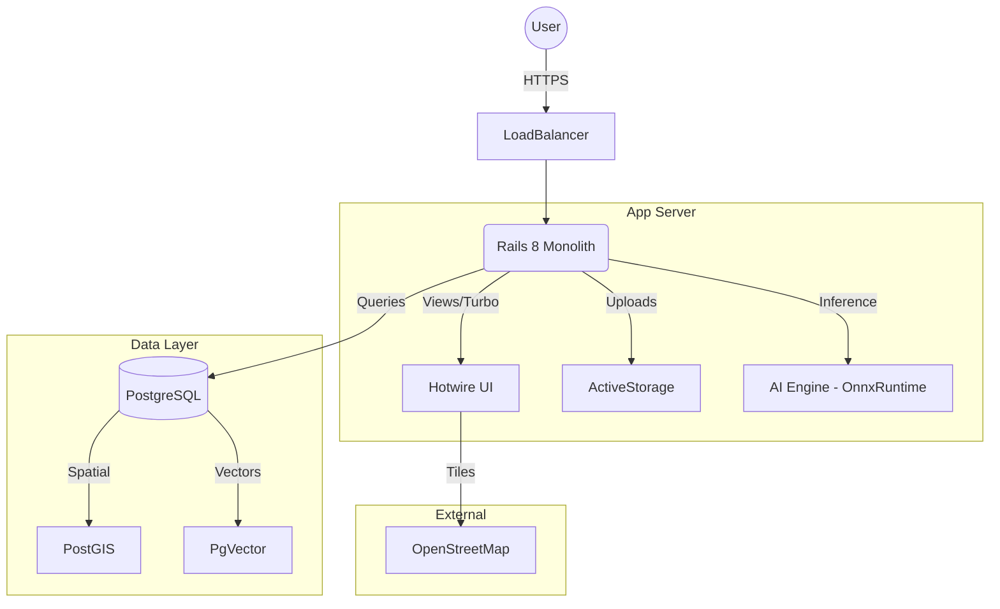

# Arquitetura do PetFindly

> Este documento detalha as decisões técnicas, stack e fluxo de dados do PetFindly.

## **Tecnologias Utilizadas**

### **Back-End:**

- Ruby 3.4
- Ruby on Rails 8 (Modular Monolith)
- Database: PostgreSQL 16+
  - Extensions: `postgis` (Geo), `pgvector` (AI)

### **IA (Zero Cost / On-Premise):**

- **Engine:** `onnxruntime` (Ruby Gem)
- **Model:** Quantized CLIP / MobileNet (Running locally)
- **Search:** Vector Similarity Search via `pgvector`

### **Front-End:**

- Rails 8 + Hotwire (Turbo & Stimulus)
- TailwindCSS

### **Geolocalização e Mapas:**

- **Backend:** PostGIS
- **Frontend:** Leaflet.js + OpenStreetMap (Free Tiles)

## **Arquitetura (High Level)**

